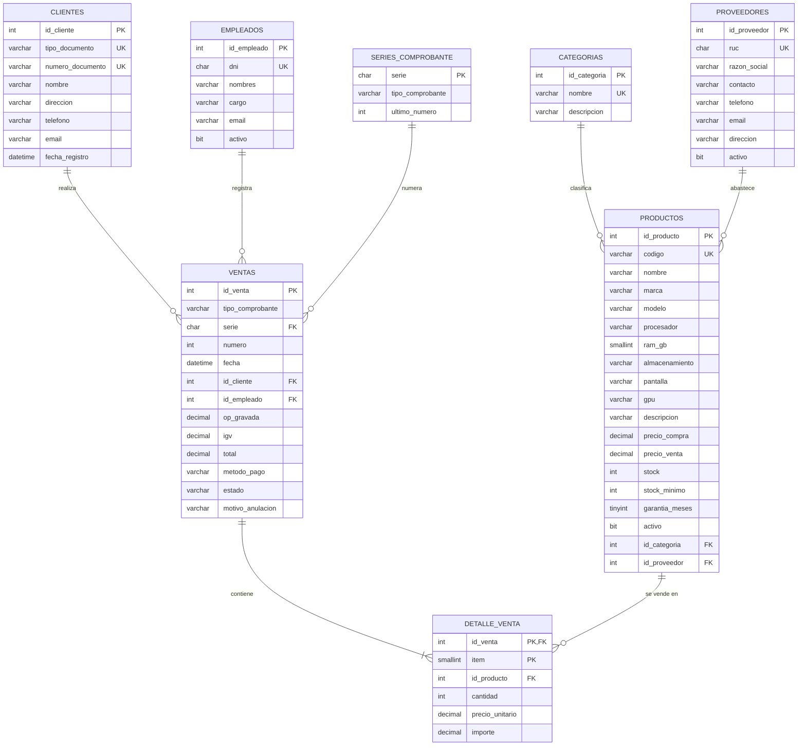

# 1. Diagrama Entidad-Relación y Modelo Relacional

## 1.1 Modelo conceptual – Diagrama Entidad-Relación (DER)

> GitHub dibuja este diagrama automáticamente (Mermaid).

### Reglas de negocio

| # | Regla | Cómo se implementa |
|---|-------|--------------------|
| RN-01 | Un producto pertenece a una categoría y tiene un proveedor. | FK `fk_productos_categoria`, `fk_productos_proveedor` |
| RN-02 | Una venta pertenece a un cliente y la registra un empleado. | FK `fk_ventas_cliente`, `fk_ventas_empleado` |
| RN-03 | Una venta tiene uno o más productos en su detalle. | `sp_registrar_venta` valida que la lista no esté vacía |
| RN-04 | Cliente con RUC → FACTURA (F001); con DNI/CE → BOLETA (B001). | `sp_registrar_venta` |
| RN-05 | El número del comprobante es correlativo y no se repite. | Tabla `series_comprobante` + `UNIQUE (serie, numero)` |
| RN-06 | No se puede vender más que el stock disponible. | `sp_registrar_venta` + `CHECK (stock >= 0)` |
| RN-07 | El precio de venta incluye IGV (18 %). `op_gravada = total / 1.18`, `igv = total − op_gravada`. | `sp_registrar_venta` + `CHECK (total = op_gravada + igv)` |
| RN-08 | El precio de venta no puede ser menor al de compra. | `CHECK ck_productos_precios` |
| RN-09 | Una venta no se elimina: se anula y el stock se devuelve. | `sp_anular_venta` |
| RN-10 | El detalle guarda el precio del momento de la venta. | Columna `detalle_venta.precio_unitario` |

## 1.2 Modelo lógico – Modelo relacional

Notación: **PK** en negrita, *FK* en cursiva.

- **CATEGORIAS** (**id_categoria**, nombre, descripcion)
- **PROVEEDORES** (**id_proveedor**, ruc, razon_social, contacto, telefono, email, direccion, activo)
- **PRODUCTOS** (**id_producto**, codigo, nombre, marca, modelo, procesador, ram_gb, almacenamiento, pantalla, gpu, descripcion, precio_compra, precio_venta, stock, stock_minimo, garantia_meses, activo, *id_categoria*, *id_proveedor*)
- **CLIENTES** (**id_cliente**, tipo_documento, numero_documento, nombre, direccion, telefono, email, fecha_registro)
- **EMPLEADOS** (**id_empleado**, dni, nombres, cargo, email, activo)
- **SERIES_COMPROBANTE** (**serie**, tipo_comprobante, ultimo_numero)
- **VENTAS** (**id_venta**, tipo_comprobante, *serie*, numero, fecha, *id_cliente*, *id_empleado*, op_gravada, igv, total, metodo_pago, estado, motivo_anulacion)
- **DETALLE_VENTA** (***id_venta*, item**, *id_producto*, cantidad, precio_unitario, importe)

### Relaciones

| Relación | Cardinalidad | Llave foránea | ON DELETE |
|----------|:------------:|---------------|-----------|
| CATEGORIAS – PRODUCTOS | 1 : N | `productos.id_categoria → categorias.id_categoria` | RESTRICT |
| PROVEEDORES – PRODUCTOS | 1 : N | `productos.id_proveedor → proveedores.id_proveedor` | RESTRICT |
| CLIENTES – VENTAS | 1 : N | `ventas.id_cliente → clientes.id_cliente` | RESTRICT |
| EMPLEADOS – VENTAS | 1 : N | `ventas.id_empleado → empleados.id_empleado` | RESTRICT |
| SERIES_COMPROBANTE – VENTAS | 1 : N | `ventas.serie → series_comprobante.serie` | RESTRICT |
| VENTAS – DETALLE_VENTA | 1 : N (identificadora) | `detalle_venta.id_venta → ventas.id_venta` | CASCADE |
| PRODUCTOS – DETALLE_VENTA | 1 : N | `detalle_venta.id_producto → productos.id_producto` | RESTRICT |

La relación muchos a muchos entre **VENTAS** y **PRODUCTOS** se resuelve con la tabla intermedia **DETALLE_VENTA**.

### Normalización
- **1FN:** todos los atributos son atómicos; no hay grupos repetitivos (los productos de una venta van en filas de `detalle_venta`).
- **2FN:** en `detalle_venta` (PK compuesta) cada atributo depende de la llave completa; los datos del producto (nombre, marca) están en `productos`.
- **3FN:** no hay dependencias transitivas; categoría, proveedor, cliente y empleado están en sus propias tablas.
- `precio_unitario` en el detalle y los totales en `ventas` se guardan a propósito (desnormalización controlada): son datos históricos del comprobante y no deben cambiar si luego cambia el precio del producto.

## 1.3 Modelo físico
Implementado en SQL Server (T-SQL) en [`sql/01_ddl_creacion_tablas.sql`](../sql/01_ddl_creacion_tablas.sql). Tipos de datos y restricciones de cada columna: [02_diccionario_datos.md](02_diccionario_datos.md).
